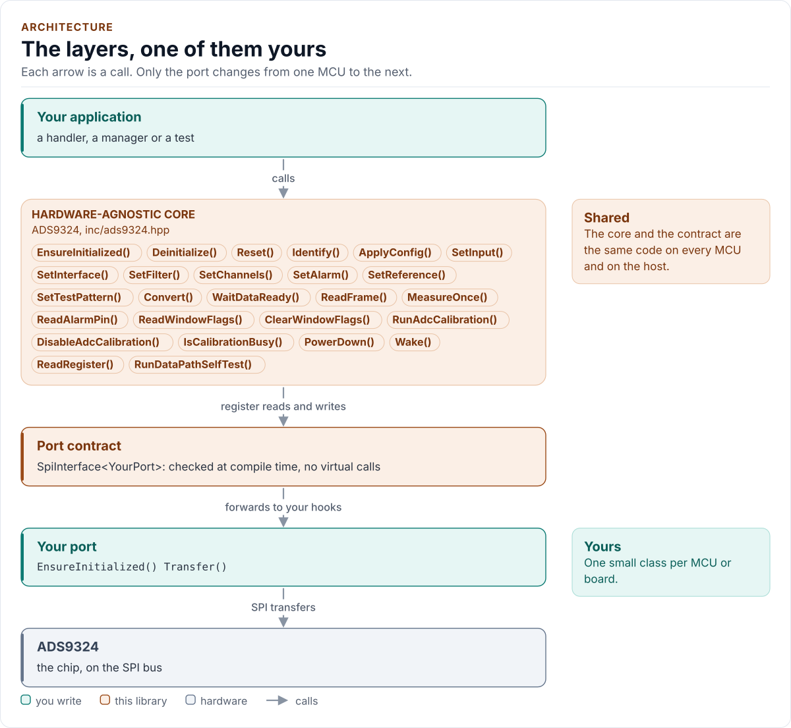
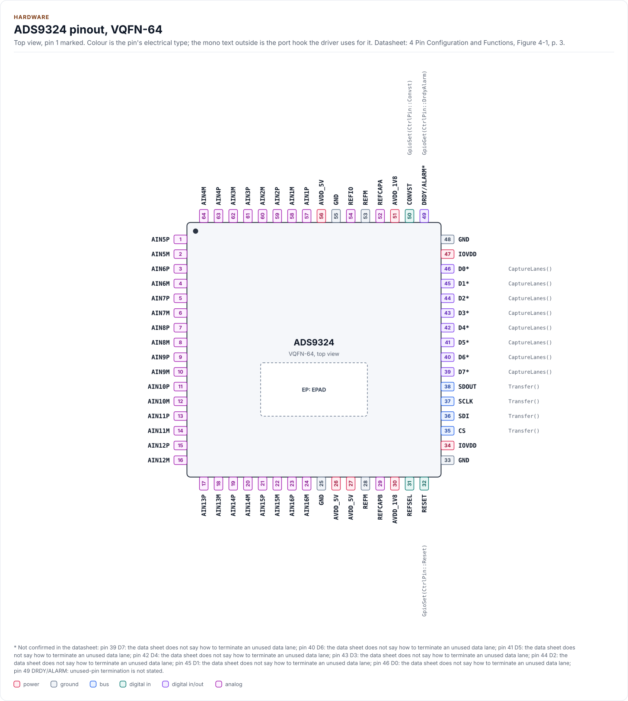
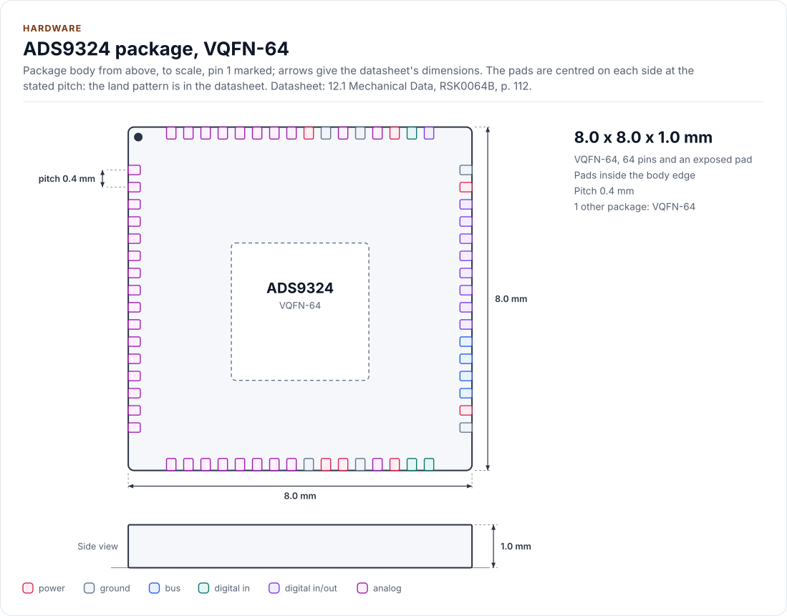
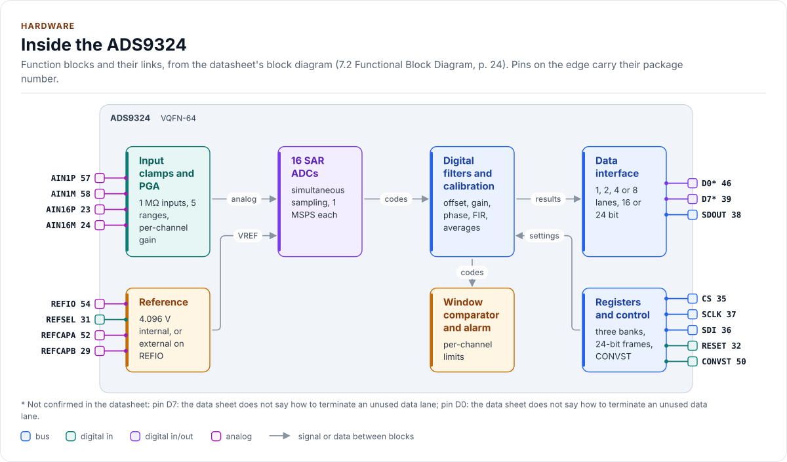

# ADS9324 Driver

C++20 driver for the TI ADS9324 16-channel, 16-bit, 1 MSPS simultaneous-sampling SAR ADC with integrated PGA and
SPI interface.

[](https://github.com/kokeb-labs-drivers/driver-ads9324/actions/workflows/ci.yml)
[](LICENSE)
[](docs/installation.md#requirements)

**Documentation: [`docs/`](docs/index.md)**, with the API reference built by Doxygen ([how](docs/api-reference.md)).
The site at <https://kokeb-labs-drivers.github.io/driver-ads9324/> opens when the repository is public.


The ADS9324 samples sixteen analog inputs at the same instant, each through its own programmable-gain front end
with 1 MΩ input impedance, and converts them to 16 bits at up to 1 MSPS per channel: current and voltage channels
of a power-system monitor, a bank of sensors, a test instrument. This driver starts the chip safely, programs every
channel (range, differential or single-ended, bandwidth, offset, gain, window), reads and decodes a whole frame of
16 samples in any lane and word format, runs the window comparator and the ADC calibration, and turns the chip's
flags into errors you can act on. It runs on any MCU: you give it a small class that moves SPI frames and waits,
and it does the rest.

<!-- figure: driver-layers -->
<picture>
  <source media="(prefers-color-scheme: dark)" srcset="docs/diagrams/driver-layers.dark.svg">
  
</picture>
<!-- /figure -->

## At a glance

| | |
| --- | --- |
| **Chip** | TI ADS9324, 16 channels, 16 bits, simultaneous sampling; 64-pin VQFN |
| **Converts** | ±2.5 V to ±12.5 V per channel, differential or single-ended; up to 1 MSPS per channel; internal 4.096 V or external reference |
| **Bus** | SPI mode 0, 24-bit register frames up to 60 MHz (reads on SDOUT up to 29 MHz); data on 1, 2, 4 or 8 lanes, 16 or 24 bits per channel |
| **Also drives** | CONVST, RESET and DRDY/ALARM through optional port hooks; filters, window comparator, calibration, standby |
| **Driver** | Header-only C++20; no heap, exceptions, RTTI, floating point or virtual calls; every call returns `Result<T>` |
| **Runs on** | Any MCU with SPI and a C++20 compiler; the host example runs on any PC ([Platforms](docs/platforms.md)) |
| **Not supported** | The daisy chain ([Limitations](docs/limitations.md)) |
| **Status** | 0.1.0, **not verified on hardware**: host-tested against a model of the chip and fuzzed; bench steps in [Limitations](docs/limitations.md) |

<!-- figure: chip-pinout -->
<picture>
  <source media="(prefers-color-scheme: dark)" srcset="docs/diagrams/chip-pinout.dark.svg">
  
</picture>
<!-- /figure -->

<!-- figure: chip-outline -->
<picture>
  <source media="(prefers-color-scheme: dark)" srcset="docs/diagrams/chip-outline.dark.svg">
  
</picture>
<!-- /figure -->

<!-- figure: chip-blocks -->
<picture>
  <source media="(prefers-color-scheme: dark)" srcset="docs/diagrams/chip-blocks.dark.svg">
  
</picture>
<!-- /figure -->

<!-- generated: chip-card -->
| | | Datasheet |
| --- | --- | --- |
| **Package** | VQFN-64, exposed pad | 4, [p. 3](https://www.ti.com/lit/ds/symlink/ads9324.pdf#page=3) |
| **Pins** | 64 | 4, [p. 3](https://www.ti.com/lit/ds/symlink/ads9324.pdf#page=3) |
| **Body size** | 8.0 x 8.0 x 1.0 mm | 12.1, [p. 112](https://www.ti.com/lit/ds/symlink/ads9324.pdf#page=112) |
| **Pin pitch** | 0.4 mm | 12.1, [p. 112](https://www.ti.com/lit/ds/symlink/ads9324.pdf#page=112) |
| **Variants** | `rsk0064e` (below) | 12.1, [p. 112](https://www.ti.com/lit/ds/symlink/ads9324.pdf#page=112) |
| **Supply AVDD_5V** | 4.75 V to 5.25 V | 5.3, [p. 6](https://www.ti.com/lit/ds/symlink/ads9324.pdf#page=6) |
| **Supply AVDD_1V8** | 1.7 V to 1.9 V | 5.3, [p. 6](https://www.ti.com/lit/ds/symlink/ads9324.pdf#page=6) |
| **Supply IOVDD** | 1.7 V to 3.6 V | 5.3, [p. 6](https://www.ti.com/lit/ds/symlink/ads9324.pdf#page=6) |

Also sold as:

| Variant | Package | Pins | Size | Ordering | Note | Datasheet |
| --- | --- | --- | --- | --- | --- | --- |
| `rsk0064e` | VQFN-64 | 64 | 8.0 x 8.0 x 1.0 mm | ADS9324RSKR | second drawing, RSK0064E, with a 5.56 mm pad (RSK0064B: 5.31 mm) | 12.1, [p. 112](https://www.ti.com/lit/ds/symlink/ads9324.pdf#page=112) |

From [`docs/hardware.yml`](docs/hardware.yml); pins, circuits and the block diagram: [Hardware](docs/hardware.md).
<!-- /generated -->

## Datasheet

<!-- generated: datasheet-card -->
| Document | Revision | Get it |
| --- | --- | --- |
| Datasheet: ADS9324 16-Channel, 16-Bit, 1MSPS, Simultaneous-Sampling SAR ADC With Integrated Analog Front-End (Texas Instruments SBASB22) | -, 2025-12 | [PDF](https://www.ti.com/lit/ds/symlink/ads9324.pdf) · [vendor page](https://www.ti.com/product/ADS9324) |

Written against these revisions; the SHA-256 of each file is in [`docs/datasheets.yml`](docs/datasheets.yml). Where each
part of the driver is in the datasheet: [Datasheet map](docs/datasheet.md).
<!-- /generated -->

Every docs page lists the datasheet sections it relies on, and code comments cite the section they implement.

## Try it on your PC

No hardware needed: [`examples/host`](examples/host/README.md) runs the driver against a simulated chip.
You need git, CMake 3.16+ and a C++20 compiler (GCC 10+, Clang 13+ or MSVC 2022).

1. Get the source:

   ```bash
   git clone https://github.com/kokeb-labs-drivers/driver-ads9324.git && cd driver-ads9324
   ```

2. Build and run the example:

   ```bash
   cmake -S examples/host -B build-example
   cmake --build build-example
   ./build-example/ads9324_host_example
   ```

3. You should see the driver start the simulated chip, read the 16 channels, watch a window and calibrate:

   ```text
   ADS9324 driver 0.1.0 on the host
   ads9324: initialised
     AIN1    -3996 mV
     ...
     AIN16    3503 mV
   window alert pin asserted, low flags 0x0004
   calibration done, mode kept: idle
   ```

To run the whole test suite instead: `cmake -S . -B build -DADS9324_BUILD_TESTS=ON && cmake --build build && ctest
--test-dir build`.

## Use it on your MCU

**1. Wire it** ([Hardware](docs/hardware.md) has every pin, the timing and the power):

| MCU | ADS9324 | Notes |
| --- | --- | --- |
| SPI SCLK | SCLK | Mode 0, up to 60 MHz; 1 MHz for bring-up on jumper wires |
| SPI MOSI | SDI | |
| SPI MISO | SDOUT | The registers and, by default, the data of all 16 channels |
| GPIO (chip select) | CS | Low for the whole frame: one transfer per frame |
| GPIO | CONVST | Idles high; the falling edge samples all 16 channels |
| GPIO | RESET | Idles high; optional |
| GPIO input | DRDY/ALARM | Optional: the driver waits for the result on it |
| 5 V, 1.8 V, 1.7 V to 3.6 V | AVDD_5V, AVDD_1V8, IOVDD | 1 µF and 0.1 µF at each supply pin |
| GND | GND, REFM, exposed pad | |

**2. Write the port**: a class with `EnsureInitialized()` (bring the bus up), `Transfer()` (one full-duplex frame
with CS low) and `DelayUs()`, about 20 lines on most SDKs, plus `GpioSet()` for CONVST and RESET.
[Porting](docs/porting.md) has the contract and a complete example.

**3. Read a frame:**

<!-- generated: quickstart-code -->
```cpp
#include "ads9324.hpp"

// This minimal port has no CONVST pin hook, so the example drives CONVST itself
// (see "Drive CONVST yourself" on the API guide); ReadFrame() reads the latest
// conversion.
int read_ain1_microvolts(MyPort& port, int32_t& microvolts) {
  ads9324::ADS9324<MyPort> adc(port); // no I/O yet

  if (auto r = adc.EnsureInitialized(); !r) { // 1. bus up, reset, DEVICE_ID, Config{}
    return static_cast<int>(r.error);         //    Bus, Timeout or DeviceIdMismatch: check wiring
  }
  // ... pulse CONVST here, wait 1.25 us ...
  const auto frame = adc.ReadFrame(); // 2. one frame: all 16 channels, 16 bits each
  if (!frame) {
    return static_cast<int>(frame.error); //    DataMismatch: SDOUT stuck low or high
  }
  microvolts = frame.value.microvolts[0]; // 3. AIN1, +-5 V range, in microvolts
  return 0;
}
```
<!-- /generated -->

`EnsureInitialized()` is the only call that starts the chip. Every other call returns `Error::NotInitialized`
until it has succeeded, and no read ever starts the chip on its own.

## What it does

- Brings the chip up with a reset, a DEVICE_ID check and a settle wait; nothing touches the chip before that
  succeeds.
- Sets every channel's range, type, bandwidth, offset, gain, phase delay and window, in the right register of the
  mirrored AIN9 to AIN16 bank, writing only what changed.
- Reads a frame on SDOUT or on 2, 4 or 8 lanes, 16 or 24 bits, with the DIAG byte and the randomizer, and returns
  codes and microvolts per channel; a stuck or floating line is an error, not data.
- Runs the digital filters, the window comparator with its alarm pin, the ADC calibration and standby.
- Checks a configuration before any bus traffic, at run time or at compile time.
- Returns `Result<T>` with an `Error` from every call: no exceptions, no heap, no RTTI, no virtual calls.

## Add it to your project

Pick the row that matches your build; each is a few steps, and [Installation](docs/installation.md) has the
details.

| Your build | Steps below |
| --- | --- |
| Plain CMake: STM32 (CubeMX), RP2040 (Pico SDK), nRF Connect, a host app | [A](#a-cmake-any-mcu) |
| ESP-IDF | [B](#b-esp-idf) |
| An SDK or OS image that installs libraries | [C](#c-installed-package) |

### A. CMake, any MCU

1. Add the driver as a submodule, pinned to the version you chose:

   ```bash
   git submodule add https://github.com/kokeb-labs-drivers/driver-ads9324.git external/driver-ads9324
   ```

2. In your `CMakeLists.txt`, after `project()`:

   ```cmake
   add_subdirectory(external/driver-ads9324)
   target_link_libraries(my_app PRIVATE ads9324::ads9324)   # brings the headers and C++20
   ```

3. In your code, `#include "ads9324.hpp"`, write the port ([Porting](docs/porting.md)) and build. A first build
   that compiles the quickstart above is the check that the driver is wired in.

### B. ESP-IDF

1. Add the driver under your project's `components/`; ESP-IDF finds it there and names it after the folder:

   ```bash
   git submodule add https://github.com/kokeb-labs-drivers/driver-ads9324.git components/ads9324
   ```

2. In `main/CMakeLists.txt`, list it: `idf_component_register(SRCS "main.cpp" REQUIRES ads9324)`.
3. `idf.py menuconfig` now has an **ADS9324 16-channel ADC** menu (CONVST frequency, word length, DIAG byte,
   ready source), and `idf.py build` builds the driver with your app. [`examples/esp32`](examples/esp32) is a complete
   project with a port for the board.

### C. Installed package

1. Install it once into a prefix:

   ```bash
   cmake -S external/driver-ads9324 -B build-ads9324 && cmake --install build-ads9324 --prefix /opt/sdk
   ```

2. In your project, with `CMAKE_PREFIX_PATH=/opt/sdk`:

   ```cmake
   find_package(ads9324 0.1 REQUIRED)
   target_link_libraries(my_app PRIVATE ads9324::ads9324)
   ```

The target is `ads9324::ads9324` every way, so switching later changes nothing else.

## Documentation

| Page | Read it when you want to |
| --- | --- |
| [Quickstart](docs/quickstart.md) | Go from a bare chip to 16 channel readings on your MCU |
| [Hardware](docs/hardware.md) | Wire it, check the supplies, the reference, the bus settings and the timing |
| [Porting](docs/porting.md) | Write the port class for your MCU's SDK |
| [API guide](docs/api-guide.md) | Use each call: start, configure, measure, set windows, calibrate, handle errors |
| [Configuration](docs/configuration.md) | Choose every setting |
| [Limitations](docs/limitations.md) | See what is out of scope, assumed or not verified on hardware |
| [Troubleshooting](docs/troubleshooting.md) | Find the cause of an error or a wrong reading |
| [Contract](docs/contract.md) | Know exactly what the driver promises, needs and returns |
| [Datasheet map](docs/datasheet.md) | Find the datasheet section behind each part of the driver |
| [API reference](docs/api-reference.md) | Look up a class or member (Doxygen; built by CI and locally) |

## Tests and quality

```bash
cmake -S . -B build -DADS9324_BUILD_TESTS=ON && cmake --build build && ctest --test-dir build
```

The host tests run the driver against a model of the chip, fail every bus transfer in turn, and produce each error
the driver can return. A fuzzer fails, corrupts and replaces what the chip sends back and checks the
driver's promises after every call. CI also builds for Cortex-M and gates coverage, complexity, sanitizers,
fuzzing, clang-tidy, cppcheck and the handbook rules (`.kokeb/handbook.yml`). See [Testing and CI](docs/testing.md),
which lists every gate and its limit.

## License

MIT. See [LICENSE](LICENSE).
