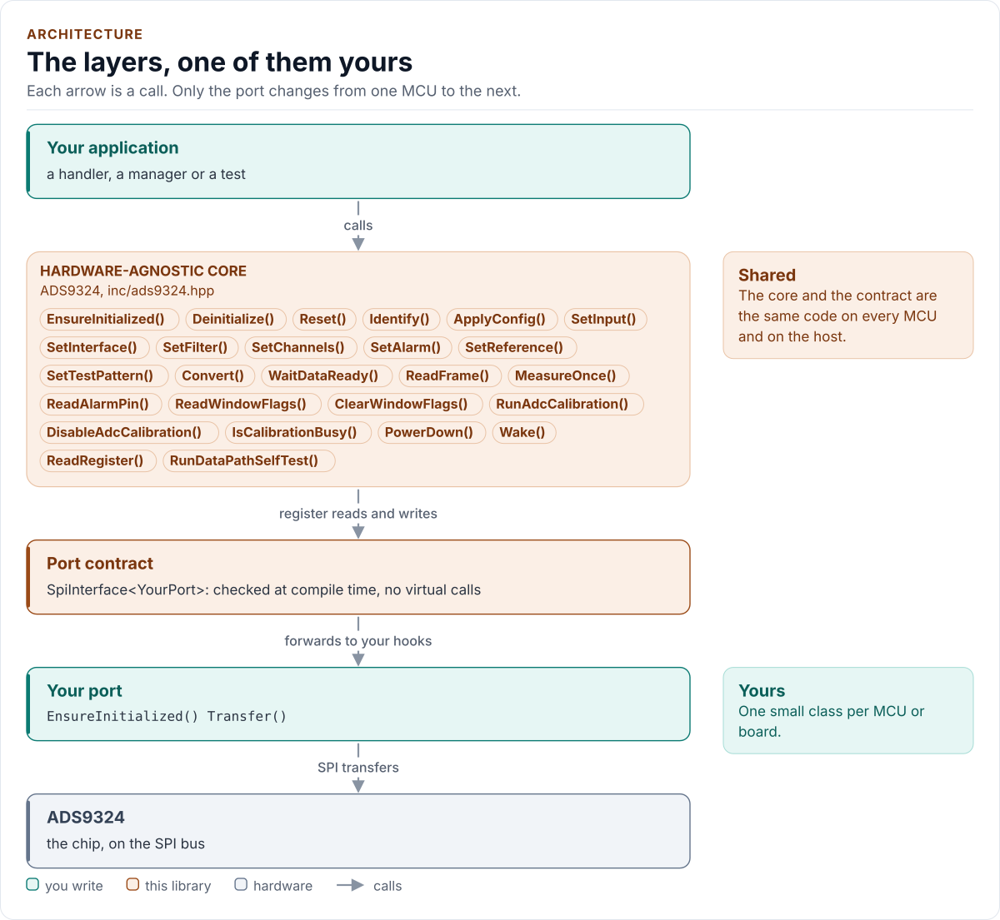
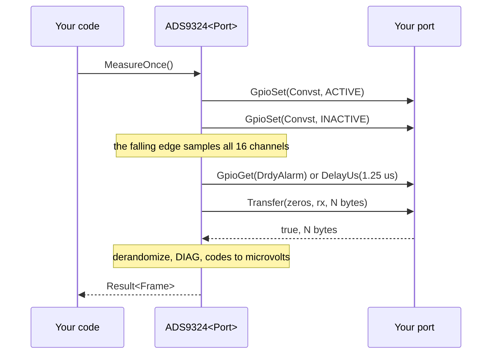

# Architecture

How the driver is built: three layers, one of them yours, and what happens in each when you read a frame.

<!-- generated: datasheet-refs -->
??? abstract "Datasheet sections this page relies on"

    From Texas Instruments SBASB22 -:

    - Data interface: lanes, word length and channel modes: 7.3.14 Data Interface; 7.3.14.1 ADC Channel Modes, Table 7-12, [p. 42](https://www.ti.com/lit/ds/symlink/ads9324.pdf#page=42)
    - Register write and read frames: 7.5 Programming; 7.5.1 Register Write Operation; 7.5.2 Register Read Operation, [p. 50](https://www.ti.com/lit/ds/symlink/ads9324.pdf#page=50)
    - Initialization example, single lane on SDOUT: 7.5.3 Initialization Example - Single Lane Mode on SDOUT, [p. 51](https://www.ti.com/lit/ds/symlink/ads9324.pdf#page=51)
    - Common registers: 8.1 ADS93xx Common Registers, [p. 53](https://www.ti.com/lit/ds/symlink/ads9324.pdf#page=53)
    - Channel registers AIN1 to AIN8: 8.2 AIN1 - AIN8 Channel Registers, [p. 64](https://www.ti.com/lit/ds/symlink/ads9324.pdf#page=64)
    - Channel registers AIN9 to AIN16 (reversed order): 8.3 AIN9 - AIN16 Channel Registers, [p. 86](https://www.ti.com/lit/ds/symlink/ads9324.pdf#page=86)

    All of them, with the driver API for each: [Datasheet map](datasheet.md).
<!-- /generated -->

<!-- figure: driver-layers -->
<picture>
  <source media="(prefers-color-scheme: dark)" srcset="diagrams/driver-layers.dark.svg">
  
</picture>
<!-- /figure -->

## Layers

| Layer | Files | Owns |
| --- | --- | --- |
| Core | [`inc/ads9324.hpp`](../inc/ads9324.hpp), [`src/ads9324.ipp`](../src/ads9324.ipp) | Lifecycle, setters, conversions, calibration, standby, errors |
| Types and encoding | [`inc/ads9324_types.hpp`](../inc/ads9324_types.hpp), [`inc/ads9324_encode.hpp`](../inc/ads9324_encode.hpp) | `Error`, `Result<T>`, `Config` and `Validate()`; the pure, constexpr `Encode()` of a `Config` into registers; the frame decoder |
| Registers | [`inc/ads9324_registers.hpp`](../inc/ads9324_registers.hpp) | The three banks, 116 registers, fields, reset values, the channel-to-register mapping |
| Port contract | [`inc/ads9324_spi_interface.hpp`](../inc/ads9324_spi_interface.hpp) | The CRTP base, `CtrlPin` and `GpioSignal`, the `SpiPort` concept, the 24-bit register framing |
| Platform port | Your class | Bus bring-up and frame transfers, optionally delays, the CONVST, RESET and DRDY pins, lane capture and logging |
| Kconfig layer | [`inc/ads9324_kconfig.hpp`](../inc/ads9324_kconfig.hpp) | Optional: a `Config` from ESP-IDF menuconfig |

## The three register banks

The chip has a common bank (18 registers) and one bank per group of eight channels (49 registers each), selected
by BANK_SEL. **The AIN9 to AIN16 bank is laid out in reverse order**: bank-local index `15 - channel`, so AIN16 is
local index 0 (the low byte of the first two-channel register), where the AIN1 to AIN8 bank puts AIN1 first. The
driver keeps one function, `reg::Locate(channel)`, that returns the bank and the local index; every register
layout rule (the low half of a two-channel register belongs to the even local index) is written once on local
indexes. A host test programs every channel with a distinct value and checks the model's registers channel by
channel, and the data-path self-test proves the same on the data side.

## Writing the configuration

`detail::Encode(Config)` is a pure function from a `Config` to a `RegisterImage`: the register values plus a mask of the
registers it touches. `ApplyConfig()` and every setter encode the new configuration, compare it with the shadow
(the register values the driver believes the chip holds) and write only what differs, in this order: the window
thresholds before DWC_EN, the filter registers, and a SYSREF pulse (CONVST 0, 1, 0) after the filter write, as the
datasheet requires. The shadow is updated after each accepted write, and the stored `Config` only when the whole
call succeeded. With `Verify::ReadBack` each written register is read back and compared.

## One call through the layers

## Design choices

- **CRTP, not virtual functions.** The port is a template parameter constrained by the `SpiPort` concept, so every
  call is resolved at compile time and a missing hook is a compile error that names it.
- **Optional hooks by named concepts.** `GpioSet`, `GpioGet`, `CaptureLanes`, `DelayUs` and `Log` are detected with
  `Declares*` and `Has*` concepts in `ads9324::detail`. A hook that is declared with a wrong signature is a compile
  error, never a silent fallback; a hook that is absent falls back in a documented way.
- **No I/O in the constructor.** Construction cannot fail, so the driver can be a static or a member of a handler.
- **One error type.** `Result<T>` carries a value and an `Error`; nothing throws and nothing returns a bare
  `bool`.
- **No heap, no exceptions, no RTTI, no floating point.** The driver is a header-only template with no mutable
  static state; voltages are integer microvolts.
- **A configuration is data.** `Validate()` and `Encode()` are constexpr, so a fixed board configuration can be
  proved valid, and its register image checked, at compile time (`CheckedConfig`).
- **The daisy chain is a seam, not a feature.** `DaisyChain` is in `Config` so the layout is stable, and
  `Validate()` refuses it; see [Limitations](limitations.md).

## Source map

| You want | Read |
| --- | --- |
| The public API | [`inc/ads9324.hpp`](../inc/ads9324.hpp) |
| How a call is implemented | [`src/ads9324.ipp`](../src/ads9324.ipp) |
| Register addresses, fields and the bank mapping | [`inc/ads9324_registers.hpp`](../inc/ads9324_registers.hpp) |
| How a `Config` becomes registers and a frame becomes codes | [`inc/ads9324_encode.hpp`](../inc/ads9324_encode.hpp) |
| The port contract | [`inc/ads9324_spi_interface.hpp`](../inc/ads9324_spi_interface.hpp) |

Next: [Contract](contract.md).
