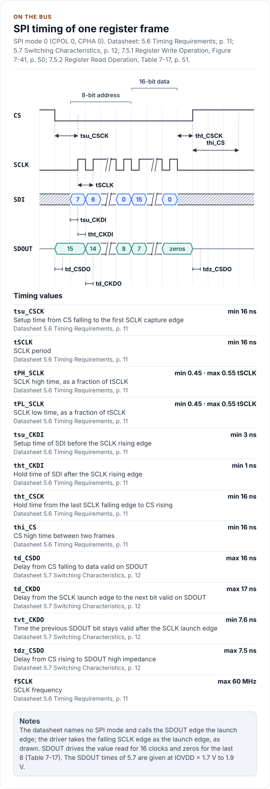
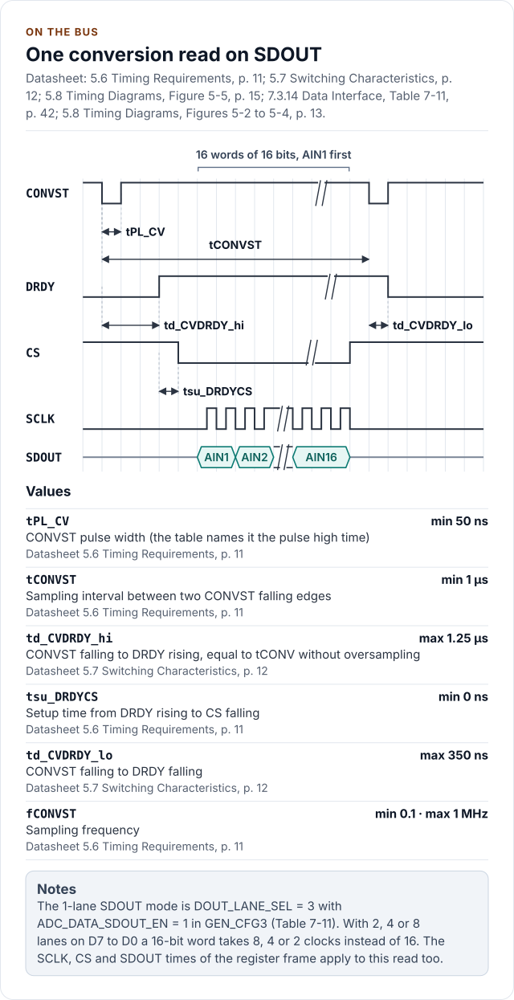
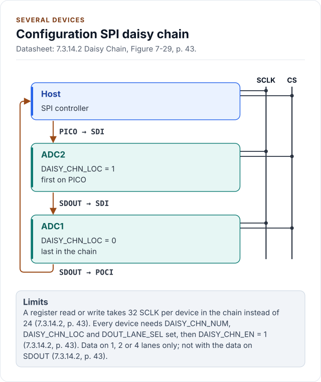

# On the bus

What the ADS9324 needs from the SPI bus and its control lines, signal by signal, with every time and rate taken from
the datasheet. The register frame bit by bit is on the [Hardware](hardware.md) page; this page is the waveform under
it.

## SPI timing

Every register access is one 24-bit frame with CS low: an 8-bit address and a 16-bit value on SDI, read on the rising
edge of SCLK and decoded when CS rises (section 7.5.1). A read takes two frames: the read command, then a frame whose
SDOUT carries the 16-bit value and eight zeros (section 7.5.2). The datasheet names no SPI mode; the driver uses
mode 0, and limits SCLK to 29 MHz whenever it reads SDOUT so that the 17 ns td_CKDO fits half a period (its own
derivation, listed in [Limitations](limitations.md)); the table's 60 MHz holds for frames that read nothing back.

<!-- figure: spi-timing -->
<picture>
  <source media="(prefers-color-scheme: dark)" srcset="diagrams/spi-timing.dark.svg">
  
</picture>
<!-- /figure -->

## Conversion data on SDOUT

The driver reads the conversion results in the 1-lane SDOUT mode by default (Table 7-11, the initialization example
of section 7.5.3): `Convert()` pulses CONVST, `WaitDataReady()` waits for DRDY (or the conversion time), and
`ReadFrame()` clocks the 16 channel words out in one CS frame. With a `CaptureLanes()` hook a port reads the same
frame on D7 alone or on 2, 4 or 8 lanes of D7 to D0 (Figures 5-2 to 5-5); the clocks per word drop as the note under
the figure says, and the SPI times above still apply.

<!-- figure: data-read -->
<picture>
  <source media="(prefers-color-scheme: dark)" srcset="diagrams/data-read.dark.svg">
  
</picture>
<!-- /figure -->

## Several devices

The datasheet describes a daisy chain on the configuration SPI (section 7.3.14.2, Figure 7-29): CS and SCLK shared,
the host's PICO into the SDI of the first device and each SDOUT into the next SDI. The driver does not support it in
this version ([Limitations](limitations.md#out-of-scope-the-daisy-chain)); without the chain, several ADS9324 share
SCLK, SDI and SDOUT and each needs its own CS.

<!-- figure: spi-chain -->
<picture>
  <source media="(prefers-color-scheme: dark)" srcset="diagrams/spi-chain.dark.svg">
  
</picture>
<!-- /figure -->

## How these figures are made

Each figure is a model in `docs/model/` (`spi-timing.timing.yml`, `data-read.timing.yml` and
`spi-chain.topology.yml`) that cites the datasheet section and page of every number; `kokeb-docs figures` draws it
and the build fails on a number without a citation. The values table under each waveform is also written as
`docs/diagrams/<id>.table.html`.
