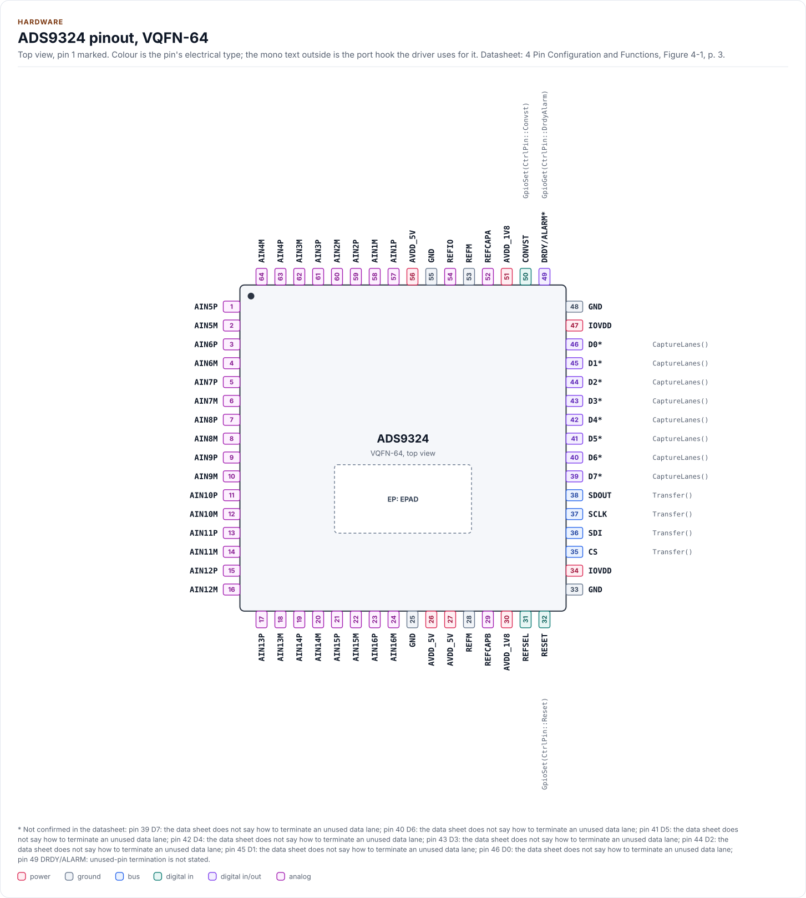
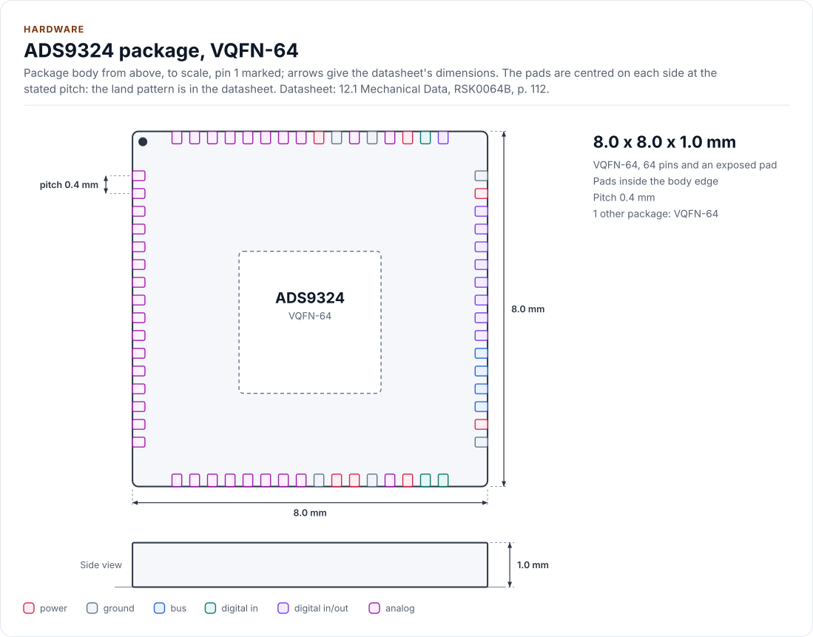
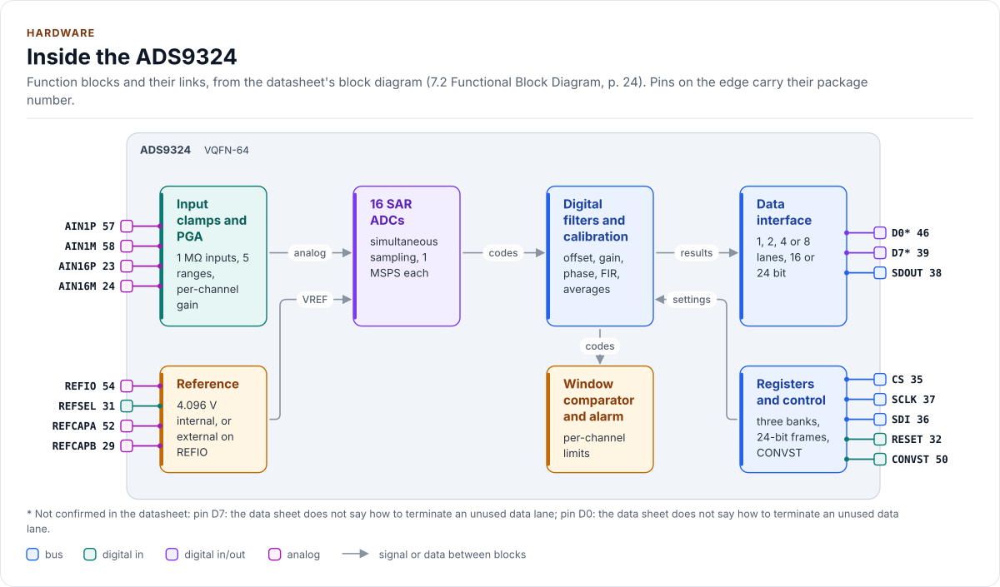
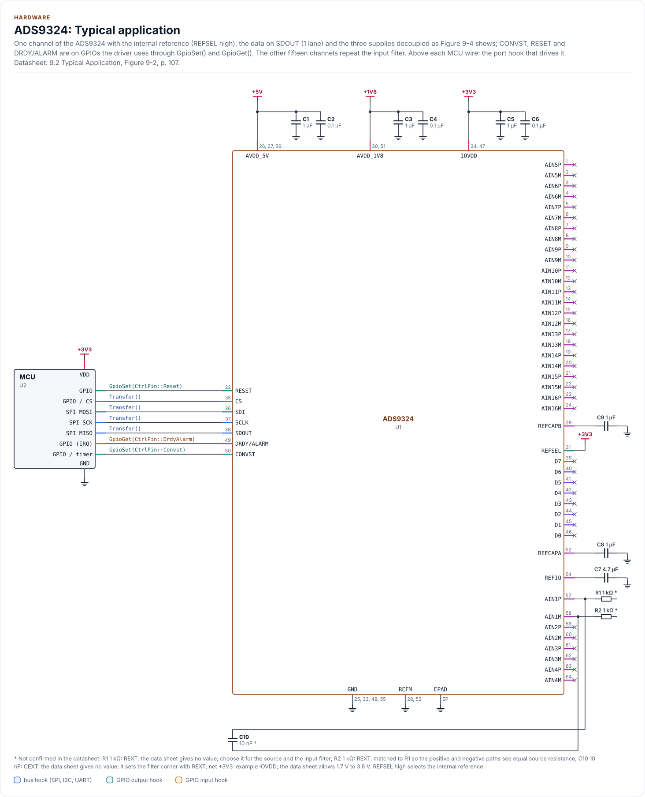
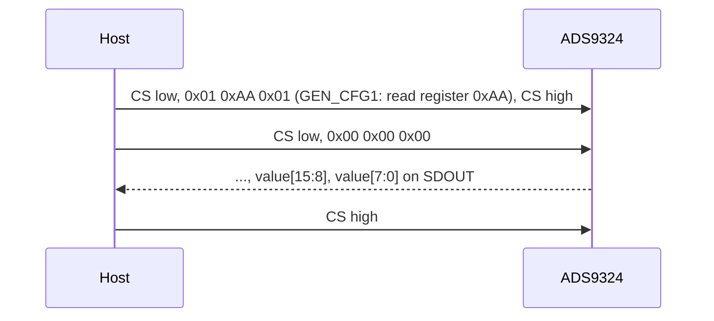

# Hardware

The ADS9324's pins, supplies, reference, bus settings and timing, as the driver uses them.

<!-- generated: datasheet-refs -->
??? abstract "Datasheet sections this page relies on"

    From Texas Instruments SBASB22 -:

    - Features, channel count and the 16 simultaneous samples: 1 Features; 3 Description, [p. 1](https://www.ti.com/lit/ds/symlink/ads9324.pdf#page=1)
    - Pins, package and the data lanes: 4 Pin Configuration and Functions, [p. 3](https://www.ti.com/lit/ds/symlink/ads9324.pdf#page=3)
    - Absolute maximum ratings: 5.1 Absolute Maximum Ratings, [p. 5](https://www.ti.com/lit/ds/symlink/ads9324.pdf#page=5)
    - Supplies, reference and input ranges: 5.3 Recommended Operating Conditions, [p. 6](https://www.ti.com/lit/ds/symlink/ads9324.pdf#page=6)
    - Electrical characteristics, power-up and reset times: 5.5 Electrical Characteristics, [p. 7](https://www.ti.com/lit/ds/symlink/ads9324.pdf#page=7)
    - SPI and CONVST timing: 5.6 Timing Requirements; 5.7 Switching Characteristics, [p. 11](https://www.ti.com/lit/ds/symlink/ads9324.pdf#page=11)
    - Analog inputs and the input clamps: 7.3.1 Analog Inputs; 7.3.2 Input Clamp Protection Circuit, [p. 25](https://www.ti.com/lit/ds/symlink/ads9324.pdf#page=25)
    - Reference selection: 7.3.6 Reference, Table 7-3, [p. 28](https://www.ti.com/lit/ds/symlink/ads9324.pdf#page=28)
    - Alarm modes and the DRDY/ALARM pin: 7.3.13 Alarm Modes, Table 7-10, [p. 41](https://www.ti.com/lit/ds/symlink/ads9324.pdf#page=41)
    - Reset: 7.4.1 Reset, [p. 49](https://www.ti.com/lit/ds/symlink/ads9324.pdf#page=49)
    - Typical application and input filter: 9.2 Typical Application, Figures 9-1 and 9-2, [p. 106](https://www.ti.com/lit/ds/symlink/ads9324.pdf#page=106)
    - Power-supply decoupling: 9.3 Power Supply Recommendations, Figure 9-4, [p. 109](https://www.ti.com/lit/ds/symlink/ads9324.pdf#page=109)
    - Layout: 9.4 Layout, [p. 109](https://www.ti.com/lit/ds/symlink/ads9324.pdf#page=109)
    - Package outline and ordering: 12 Mechanical, Packaging, and Orderable Information, [p. 112](https://www.ti.com/lit/ds/symlink/ads9324.pdf#page=112)

    All of them, with the driver API for each: [Datasheet map](datasheet.md).
<!-- /generated -->

The ADS9324 is a 16-channel, 16-bit, simultaneous-sampling SAR ADC. Each channel has its own clamp, programmable
gain amplifier (1 MΩ input impedance) and ADC; one CONVST edge samples all 16 channels together. The registers are
read and written over SPI; the conversion results come out on SDOUT (one lane) or on the D0 to D7 pins (2, 4 or 8
lanes). The driver works with the one package the datasheet lists, the 64-pin VQFN (RSK).

## Pins

The pinout, the block diagram, the circuit and the two tables on this page are drawn from
[`docs/hardware.yml`](hardware.yml).

<!-- figure: chip-pinout -->
<picture>
  <source media="(prefers-color-scheme: dark)" srcset="diagrams/chip-pinout.dark.svg">
  
</picture>
<!-- /figure -->

<!-- generated: chip-pins -->
VQFN-64, 64 pins and an exposed pad (4 Pin Configuration and Functions, Figure 4-1, [p. 3](https://www.ti.com/lit/ds/symlink/ads9324.pdf#page=3)).

| Pin | Name | Type (domain) | Function | Driver hook | If unused | Datasheet |
| --- | --- | --- | --- | --- | --- | --- |
| 1 | `AIN5P` | analog (AVDD_5V) | Analog input channel 5, positive input | - | - | 4, [p. 3](https://www.ti.com/lit/ds/symlink/ads9324.pdf#page=3) |
| 2 | `AIN5M` | analog (AVDD_5V) | Analog input channel 5, negative input | - | - | 4, [p. 3](https://www.ti.com/lit/ds/symlink/ads9324.pdf#page=3) |
| 3 | `AIN6P` | analog (AVDD_5V) | Analog input channel 6, positive input | - | - | 4, [p. 3](https://www.ti.com/lit/ds/symlink/ads9324.pdf#page=3) |
| 4 | `AIN6M` | analog (AVDD_5V) | Analog input channel 6, negative input | - | - | 4, [p. 3](https://www.ti.com/lit/ds/symlink/ads9324.pdf#page=3) |
| 5 | `AIN7P` | analog (AVDD_5V) | Analog input channel 7, positive input | - | - | 4, [p. 3](https://www.ti.com/lit/ds/symlink/ads9324.pdf#page=3) |
| 6 | `AIN7M` | analog (AVDD_5V) | Analog input channel 7, negative input | - | - | 4, [p. 3](https://www.ti.com/lit/ds/symlink/ads9324.pdf#page=3) |
| 7 | `AIN8P` | analog (AVDD_5V) | Analog input channel 8, positive input | - | - | 4, [p. 3](https://www.ti.com/lit/ds/symlink/ads9324.pdf#page=3) |
| 8 | `AIN8M` | analog (AVDD_5V) | Analog input channel 8, negative input | - | - | 4, [p. 3](https://www.ti.com/lit/ds/symlink/ads9324.pdf#page=3) |
| 9 | `AIN9P` | analog (AVDD_5V) | Analog input channel 9, positive input | - | - | 4, [p. 3](https://www.ti.com/lit/ds/symlink/ads9324.pdf#page=3) |
| 10 | `AIN9M` | analog (AVDD_5V) | Analog input channel 9, negative input | - | - | 4, [p. 3](https://www.ti.com/lit/ds/symlink/ads9324.pdf#page=3) |
| 11 | `AIN10P` | analog (AVDD_5V) | Analog input channel 10, positive input | - | - | 4, [p. 3](https://www.ti.com/lit/ds/symlink/ads9324.pdf#page=3) |
| 12 | `AIN10M` | analog (AVDD_5V) | Analog input channel 10, negative input | - | - | 4, [p. 3](https://www.ti.com/lit/ds/symlink/ads9324.pdf#page=3) |
| 13 | `AIN11P` | analog (AVDD_5V) | Analog input channel 11, positive input | - | - | 4, [p. 3](https://www.ti.com/lit/ds/symlink/ads9324.pdf#page=3) |
| 14 | `AIN11M` | analog (AVDD_5V) | Analog input channel 11, negative input | - | - | 4, [p. 3](https://www.ti.com/lit/ds/symlink/ads9324.pdf#page=3) |
| 15 | `AIN12P` | analog (AVDD_5V) | Analog input channel 12, positive input | - | - | 4, [p. 3](https://www.ti.com/lit/ds/symlink/ads9324.pdf#page=3) |
| 16 | `AIN12M` | analog (AVDD_5V) | Analog input channel 12, negative input | - | - | 4, [p. 3](https://www.ti.com/lit/ds/symlink/ads9324.pdf#page=3) |
| 17 | `AIN13P` | analog (AVDD_5V) | Analog input channel 13, positive input | - | - | 4, [p. 3](https://www.ti.com/lit/ds/symlink/ads9324.pdf#page=3) |
| 18 | `AIN13M` | analog (AVDD_5V) | Analog input channel 13, negative input | - | - | 4, [p. 3](https://www.ti.com/lit/ds/symlink/ads9324.pdf#page=3) |
| 19 | `AIN14P` | analog (AVDD_5V) | Analog input channel 14, positive input | - | - | 4, [p. 3](https://www.ti.com/lit/ds/symlink/ads9324.pdf#page=3) |
| 20 | `AIN14M` | analog (AVDD_5V) | Analog input channel 14, negative input | - | - | 4, [p. 3](https://www.ti.com/lit/ds/symlink/ads9324.pdf#page=3) |
| 21 | `AIN15P` | analog (AVDD_5V) | Analog input channel 15, positive input | - | - | 4, [p. 3](https://www.ti.com/lit/ds/symlink/ads9324.pdf#page=3) |
| 22 | `AIN15M` | analog (AVDD_5V) | Analog input channel 15, negative input | - | - | 4, [p. 3](https://www.ti.com/lit/ds/symlink/ads9324.pdf#page=3) |
| 23 | `AIN16P` | analog (AVDD_5V) | Analog input channel 16, positive input | - | - | 4, [p. 3](https://www.ti.com/lit/ds/symlink/ads9324.pdf#page=3) |
| 24 | `AIN16M` | analog (AVDD_5V) | Analog input channel 16, negative input | - | - | 4, [p. 3](https://www.ti.com/lit/ds/symlink/ads9324.pdf#page=3) |
| 25 | `GND` | ground | Ground | - | - | 4, [p. 4](https://www.ti.com/lit/ds/symlink/ads9324.pdf#page=4) |
| 26 | `AVDD_5V` | power (AVDD_5V) | 5 V analog supply, 4.75 V to 5.25 V; 1 µF and 0.1 µF to GND at each supply pin | - | - | 9.3, [p. 109](https://www.ti.com/lit/ds/symlink/ads9324.pdf#page=109) |
| 27 | `AVDD_5V` | power (AVDD_5V) | 5 V analog supply, 4.75 V to 5.25 V; 1 µF and 0.1 µF to GND at each supply pin | - | - | 9.3, [p. 109](https://www.ti.com/lit/ds/symlink/ads9324.pdf#page=109) |
| 28 | `REFM` | ground | Reference ground; short to the GND plane outside the device | - | - | 4, [p. 4](https://www.ti.com/lit/ds/symlink/ads9324.pdf#page=4) |
| 29 | `REFCAPB` | analog (AVDD_5V) | Reference amplifier output; 1 µF low-ESR X7R to REFM (pin 28) | - | - | 4, [p. 4](https://www.ti.com/lit/ds/symlink/ads9324.pdf#page=4) |
| 30 | `AVDD_1V8` | power (AVDD_1V8) | 1.8 V supply, 1.7 V to 1.9 V; 1 µF and 0.1 µF to GND at each supply pin | - | - | 9.3, [p. 109](https://www.ti.com/lit/ds/symlink/ads9324.pdf#page=109) |
| 31 | `REFSEL` | digital in (IOVDD) | Reference source: high selects the internal reference, low the external one (Table 7-3) | - | - | 7.3.6, [p. 28](https://www.ti.com/lit/ds/symlink/ads9324.pdf#page=28) |
| 32 | `RESET` | digital in (IOVDD) | Hardware reset, active low | `GpioSet(CtrlPin::Reset)` | - | 4, [p. 4](https://www.ti.com/lit/ds/symlink/ads9324.pdf#page=4) |
| 33 | `GND` | ground | Ground | - | - | 4, [p. 4](https://www.ti.com/lit/ds/symlink/ads9324.pdf#page=4) |
| 34 | `IOVDD` | power (IOVDD) | Digital I/O supply, 1.7 V to 3.6 V; 1 µF and 0.1 µF to GND at each supply pin | - | - | 9.3, [p. 109](https://www.ti.com/lit/ds/symlink/ads9324.pdf#page=109) |
| 35 | `CS` | bus (IOVDD) | SPI chip select, active low | `Transfer()` | - | 4, [p. 4](https://www.ti.com/lit/ds/symlink/ads9324.pdf#page=4) |
| 36 | `SDI` | bus (IOVDD) | SPI data in (MOSI) | `Transfer()` | - | 4, [p. 4](https://www.ti.com/lit/ds/symlink/ads9324.pdf#page=4) |
| 37 | `SCLK` | bus (IOVDD) | SPI clock, up to 60 MHz | `Transfer()` | - | 4, [p. 4](https://www.ti.com/lit/ds/symlink/ads9324.pdf#page=4) |
| 38 | `SDOUT` | bus (IOVDD) | SPI data out (MISO): register replies and the data of the 1-lane mode | `Transfer()` | - | 4, [p. 4](https://www.ti.com/lit/ds/symlink/ads9324.pdf#page=4) |
| 39 | `D7` [^1] | digital in/out (IOVDD) | Serial output data lane 7 | `CaptureLanes()` | Leave open | 4, [p. 4](https://www.ti.com/lit/ds/symlink/ads9324.pdf#page=4) |
| 40 | `D6` [^2] | digital in/out (IOVDD) | Serial output data lane 6 | `CaptureLanes()` | Leave open | 4, [p. 4](https://www.ti.com/lit/ds/symlink/ads9324.pdf#page=4) |
| 41 | `D5` [^3] | digital in/out (IOVDD) | Serial output data lane 5 | `CaptureLanes()` | Leave open | 4, [p. 4](https://www.ti.com/lit/ds/symlink/ads9324.pdf#page=4) |
| 42 | `D4` [^4] | digital in/out (IOVDD) | Serial output data lane 4 | `CaptureLanes()` | Leave open | 4, [p. 4](https://www.ti.com/lit/ds/symlink/ads9324.pdf#page=4) |
| 43 | `D3` [^5] | digital in/out (IOVDD) | Serial output data lane 3 or daisy-chain input 3 | `CaptureLanes()` | Leave open | 4, [p. 4](https://www.ti.com/lit/ds/symlink/ads9324.pdf#page=4) |
| 44 | `D2` [^6] | digital in/out (IOVDD) | Serial output data lane 2 or daisy-chain input 2 | `CaptureLanes()` | Leave open | 4, [p. 4](https://www.ti.com/lit/ds/symlink/ads9324.pdf#page=4) |
| 45 | `D1` [^7] | digital in/out (IOVDD) | Serial output data lane 1 or daisy-chain input 1 | `CaptureLanes()` | Leave open | 4, [p. 4](https://www.ti.com/lit/ds/symlink/ads9324.pdf#page=4) |
| 46 | `D0` [^8] | digital in/out (IOVDD) | Serial output data lane 0 or daisy-chain input 0 | `CaptureLanes()` | Leave open | 4, [p. 4](https://www.ti.com/lit/ds/symlink/ads9324.pdf#page=4) |
| 47 | `IOVDD` | power (IOVDD) | Digital I/O supply, 1.7 V to 3.6 V; 1 µF and 0.1 µF to GND at each supply pin | - | - | 9.3, [p. 109](https://www.ti.com/lit/ds/symlink/ads9324.pdf#page=109) |
| 48 | `GND` | ground | Ground | - | - | 4, [p. 4](https://www.ti.com/lit/ds/symlink/ads9324.pdf#page=4) |
| 49 | `DRDY/ALARM` [^9] | digital in/out (IOVDD) | Data ready or alarm, active high; polarity and source in DRDY_ALARM_SEL | `GpioGet(CtrlPin::DrdyAlarm)` | Leave open | 4, [p. 4](https://www.ti.com/lit/ds/symlink/ads9324.pdf#page=4) |
| 50 | `CONVST` | digital in (IOVDD) | Start of conversion: the falling edge samples all 16 channels (section 7.4.2); keep it high before DRDY rises in the internal oversampling mode (Figure 5-7) | `GpioSet(CtrlPin::Convst)` | - | 4, [p. 4](https://www.ti.com/lit/ds/symlink/ads9324.pdf#page=4) |
| 51 | `AVDD_1V8` | power (AVDD_1V8) | 1.8 V supply, 1.7 V to 1.9 V; 1 µF and 0.1 µF to GND at each supply pin | - | - | 9.3, [p. 109](https://www.ti.com/lit/ds/symlink/ads9324.pdf#page=109) |
| 52 | `REFCAPA` | analog (AVDD_5V) | Reference amplifier output; 1 µF low-ESR X7R to REFM (pin 53) | - | - | 4, [p. 4](https://www.ti.com/lit/ds/symlink/ads9324.pdf#page=4) |
| 53 | `REFM` | ground | Reference ground; short to the GND plane outside the device | - | - | 4, [p. 4](https://www.ti.com/lit/ds/symlink/ads9324.pdf#page=4) |
| 54 | `REFIO` | analog (AVDD_5V) | Internal reference output (REFSEL high) or external reference input (REFSEL low); 4.7 µF to REFM | - | - | 4, [p. 4](https://www.ti.com/lit/ds/symlink/ads9324.pdf#page=4) |
| 55 | `GND` | ground | Ground | - | - | 4, [p. 4](https://www.ti.com/lit/ds/symlink/ads9324.pdf#page=4) |
| 56 | `AVDD_5V` | power (AVDD_5V) | 5 V analog supply, 4.75 V to 5.25 V; 1 µF and 0.1 µF to GND at each supply pin | - | - | 9.3, [p. 109](https://www.ti.com/lit/ds/symlink/ads9324.pdf#page=109) |
| 57 | `AIN1P` | analog (AVDD_5V) | Analog input channel 1, positive input | - | - | 4, [p. 3](https://www.ti.com/lit/ds/symlink/ads9324.pdf#page=3) |
| 58 | `AIN1M` | analog (AVDD_5V) | Analog input channel 1, negative input | - | - | 4, [p. 3](https://www.ti.com/lit/ds/symlink/ads9324.pdf#page=3) |
| 59 | `AIN2P` | analog (AVDD_5V) | Analog input channel 2, positive input | - | - | 4, [p. 3](https://www.ti.com/lit/ds/symlink/ads9324.pdf#page=3) |
| 60 | `AIN2M` | analog (AVDD_5V) | Analog input channel 2, negative input | - | - | 4, [p. 3](https://www.ti.com/lit/ds/symlink/ads9324.pdf#page=3) |
| 61 | `AIN3P` | analog (AVDD_5V) | Analog input channel 3, positive input | - | - | 4, [p. 3](https://www.ti.com/lit/ds/symlink/ads9324.pdf#page=3) |
| 62 | `AIN3M` | analog (AVDD_5V) | Analog input channel 3, negative input | - | - | 4, [p. 3](https://www.ti.com/lit/ds/symlink/ads9324.pdf#page=3) |
| 63 | `AIN4P` | analog (AVDD_5V) | Analog input channel 4, positive input | - | - | 4, [p. 3](https://www.ti.com/lit/ds/symlink/ads9324.pdf#page=3) |
| 64 | `AIN4M` | analog (AVDD_5V) | Analog input channel 4, negative input | - | - | 4, [p. 3](https://www.ti.com/lit/ds/symlink/ads9324.pdf#page=3) |
| EP | `EPAD` | ground | Exposed thermal pad; connect to GND | - | - | 4, [p. 4](https://www.ti.com/lit/ds/symlink/ads9324.pdf#page=4) |

[^1]: Not confirmed in the datasheet: pin 39 (D7): the data sheet does not say how to terminate an unused data lane.
[^2]: Not confirmed in the datasheet: pin 40 (D6): the data sheet does not say how to terminate an unused data lane.
[^3]: Not confirmed in the datasheet: pin 41 (D5): the data sheet does not say how to terminate an unused data lane.
[^4]: Not confirmed in the datasheet: pin 42 (D4): the data sheet does not say how to terminate an unused data lane.
[^5]: Not confirmed in the datasheet: pin 43 (D3): the data sheet does not say how to terminate an unused data lane.
[^6]: Not confirmed in the datasheet: pin 44 (D2): the data sheet does not say how to terminate an unused data lane.
[^7]: Not confirmed in the datasheet: pin 45 (D1): the data sheet does not say how to terminate an unused data lane.
[^8]: Not confirmed in the datasheet: pin 46 (D0): the data sheet does not say how to terminate an unused data lane.
[^9]: Not confirmed in the datasheet: pin 49 (DRDY/ALARM): unused-pin termination is not stated.

Source of this table and of the chip figures: [`docs/hardware.yml`](hardware.yml).
<!-- /generated -->

The package outline, drawn to scale:

<!-- figure: chip-outline -->
<picture>
  <source media="(prefers-color-scheme: dark)" srcset="diagrams/chip-outline.dark.svg">
  
</picture>
<!-- /figure -->

## Inside the chip

<!-- figure: chip-blocks -->
<picture>
  <source media="(prefers-color-scheme: dark)" srcset="diagrams/chip-blocks.dark.svg">
  
</picture>
<!-- /figure -->

## Typical application

One channel with the internal reference (REFSEL high), the data on SDOUT and the three supplies decoupled as
Figure 9-4 shows. The other fifteen channels repeat the input filter of the first. The series resistors and the
capacitor of the filter are values you choose: the datasheet gives the matched topology (Figure 9-2) and says to
match the source resistance on both inputs, not a value.

<!-- figure: chip-circuit-typical -->
<picture>
  <source media="(prefers-color-scheme: dark)" srcset="diagrams/chip-circuit-typical.dark.svg">
  
</picture>
<!-- /figure -->

<!-- generated: chip-parts -->
| Part | Kind | Value | Connects | Datasheet |
| --- | --- | --- | --- | --- |
| U2 | MCU | - | VDD: +3V3, GND: GND, SCK: SCLK, MOSI: SDI, MISO: SDOUT, CS: CS, RST: RESET, CNV: CONVST, RDY: DRDY | 9.2, [p. 107](https://www.ti.com/lit/ds/symlink/ads9324.pdf#page=107) |
| C1 | capacitor | 1 µF | +5V, GND | 9.3, [p. 109](https://www.ti.com/lit/ds/symlink/ads9324.pdf#page=109) |
| C2 | capacitor | 0.1 µF | +5V, GND | 9.3, [p. 109](https://www.ti.com/lit/ds/symlink/ads9324.pdf#page=109) |
| C3 | capacitor | 1 µF | +1V8, GND | 9.3, [p. 109](https://www.ti.com/lit/ds/symlink/ads9324.pdf#page=109) |
| C4 | capacitor | 0.1 µF | +1V8, GND | 9.3, [p. 109](https://www.ti.com/lit/ds/symlink/ads9324.pdf#page=109) |
| C5 | capacitor | 1 µF | +3V3, GND | 9.3, [p. 109](https://www.ti.com/lit/ds/symlink/ads9324.pdf#page=109) |
| C6 | capacitor | 0.1 µF | +3V3, GND | 9.3, [p. 109](https://www.ti.com/lit/ds/symlink/ads9324.pdf#page=109) |
| C7 | capacitor | 4.7 µF | GND, REFIO | 4, [p. 4](https://www.ti.com/lit/ds/symlink/ads9324.pdf#page=4) |
| C8 | capacitor | 1 µF | GND, REFCAPA | 4, [p. 4](https://www.ti.com/lit/ds/symlink/ads9324.pdf#page=4) |
| C9 | capacitor | 1 µF | GND, REFCAPB | 4, [p. 4](https://www.ti.com/lit/ds/symlink/ads9324.pdf#page=4) |
| R1 | resistor | 1 kΩ (not confirmed: REXT: the data sheet gives no value; choose it for the source and the input filter) | IN1P | 9.2, [p. 107](https://www.ti.com/lit/ds/symlink/ads9324.pdf#page=107) |
| R2 | resistor | 1 kΩ (not confirmed: REXT: matched to R1 so the positive and negative paths see equal source resistance) | IN1M | 9.2, [p. 107](https://www.ti.com/lit/ds/symlink/ads9324.pdf#page=107) |
| C10 | capacitor | 10 nF (not confirmed: CEXT: the data sheet gives no value; it sets the filter corner with REXT) | IN1P, IN1M | 9.2, [p. 107](https://www.ti.com/lit/ds/symlink/ads9324.pdf#page=107) |

Export a circuit for a schematic or PCB tool: `kokeb-docs hardware --kicad-netlist OUT.net --circuit typical`.
<!-- /generated -->

Export the circuit for a schematic or PCB tool: `kokeb-docs hardware --kicad-netlist OUT.net --circuit typical`.

## Supplies

| Rail | Pins | Range | At each pin |
| --- | --- | --- | --- |
| AVDD_5V | 26, 27, 56 | 4.75 V to 5.25 V | 1 µF and 0.1 µF to GND |
| AVDD_1V8 | 30, 51 | 1.7 V to 1.9 V | 1 µF and 0.1 µF to GND |
| IOVDD | 34, 47 | 1.7 V to 3.6 V (the data timing is specified at 1.7 V to 1.9 V) | 1 µF and 0.1 µF to GND |

There is no required power-up order. With a 1.8 V IOVDD, AVDD_1V8 may be tied to IOVDD through a 100 Ω ferrite
bead (section 9.3). `Config::supply` takes the rails in millivolts so `Validate()` can reject a value outside these
ranges; leave a rail at 0 when you do not want it checked. The absolute maximum ratings (section 5.1) are
documentation only: AIN pins to ±18 V, input current 10 mA, so a series resistor on every input is required
when a source can exceed the rating.

## Reference

| `ReferenceSource` | REFSEL pin | Result |
| --- | --- | --- |
| `Pin` (reset value) | high | Internal 4.096 V reference |
| `Pin` | low | External reference on REFIO |
| `Internal` | ignored | Internal reference |
| `External` | ignored | External reference on REFIO |

REFIO takes 4.7 µF to REFM; REFCAPA and REFCAPB each take 1 µF (low ESR, X7R) to REFM. With the external source
the reference must be 4.096 V (4.086 V to 4.106 V). `SetReference()` waits 30 ms for the reference to settle.
The driver never drives REFSEL: tie it, or let `Pin` follow the board.

## Control pins

Each control pin has a defined idle level, and the port drives it there before it enables the pin's output and
before the driver's first transfer (handbook KB-HW-018): configuring a pin as an output first and setting its level
afterwards gives the chip a pulse it did not ask for, a reset or a conversion.

| `CtrlPin` | Package pin | Polarity | Idle level | Hook |
| --- | --- | --- | --- | --- |
| `Reset` | RESET (32) | active low | high (`INACTIVE`) | `GpioSet()` |
| `Convst` | CONVST (50) | the falling edge samples; `ACTIVE` is high | high (`ACTIVE`) | `GpioSet()` |
| `DrdyAlarm` | DRDY/ALARM (49) | active high; `Alarm::active_low` inverts it | an input | `GpioGet()` |

A pin tied on the board needs no hook: RESET tied high leaves `Reset(ResetKind::Hardware)` returning
`Error::Unsupported`, and a CONVST driven by a timer is used with `ReadFrame()` instead of `MeasureOnce()`.

## Bus settings

| Setting | Value |
| --- | --- |
| SPI mode | 0 (CPOL = 0, CPHA = 0); the datasheet names none, mode 0 follows its timing diagram (assumption A1) |
| Clock | Up to 60 MHz for writes (`kMaxClockHz`); up to 29 MHz when SDOUT is read (`kMaxSdoutClockHz`): above it the 17 ns SDOUT delay no longer fits half a period in mode 0 |
| Bit order | MSB first |
| Register frame | 24 bits: 8 address bits, then 16 data bits; CS low for the whole frame |
| Register read | Select the bank (BANK_SEL), write GEN_CFG1 with the address and the read bit, then clock one frame of zeros: the reply carries the data |
| Data frame | 16 or 24 bits per channel, up to 16 channels, plus an optional DIAG byte and a PRBS byte: at most 50 bytes |
| Chip select | `kMinCsHighNs` (16 ns) high between frames; one transfer per frame |

On a data readout the driver always sends zeros, so no register is written by accident while the data is clocked
out (assumption A9).

## Timing

| Parameter | Value | Driver |
| --- | --- | --- |
| Power-up to the first access | 30 ms | `kPowerUpMs`: waited by `EnsureInitialized()` before the first frame |
| Reset | 30 ms | `kResetMs`: waited after a software or hardware reset |
| RESET low pulse | 1 ms | `kResetPulseUs`: the datasheet gives none, so a long pulse is a design choice |
| CONVST frequency | 100 kHz to 1 MHz | `kConvstMinHz`, `kConvstMaxHz`, `Sampling::convst_hz` |
| CONVST high and low | 50 ns minimum each | `kConvstHighMinNs`, `kConvstLowMinNs` |
| Conversion | 1.25 µs | `kConversionNs`; the timed ready wait |
| DRDY low after CONVST | 350 ns | `kDrdyLowDelayNs` |
| Single-shot ADC calibration | 125 ms | `kSingleShotCalMs` plus a 25 ms margin of polling |
| Continuous ADC calibration | 100,000 CONVST periods | `kContinuousCalConvst` |

The power-up and reset times are the longest the datasheet implies and are reported as ambiguous in its text
(assumption A3); [Limitations](limitations.md) lists them.

## Unused pins

The datasheet does not say how to terminate unused analog inputs or data lanes, so the driver and the figure make
no claim (**not verified on hardware**). Bench step: with the data on SDOUT, leave D0 to D7 open and check that the
self-test (`RunDataPathSelfTest()`) passes; for an unused input pair, read its channel with a test pattern off and
check the code is stable. A floating pair in open-wire safe mode reads near zero code (section 7.3.7).

## Reference documents

The datasheet:
[ADS9324 datasheet](https://www.ti.com/lit/ds/symlink/ads9324.pdf). Every pin, setting and timing on this page cites
a section of it; its revision, its SHA-256 and the sections each page relies on are in
[`docs/datasheets.yml`](datasheets.yml).

<!-- generated: datasheet-card -->
| Document | Revision | Get it |
| --- | --- | --- |
| Datasheet: ADS9324 16-Channel, 16-Bit, 1MSPS, Simultaneous-Sampling SAR ADC With Integrated Analog Front-End (Texas Instruments SBASB22) | -, 2025-12 | [PDF](https://www.ti.com/lit/ds/symlink/ads9324.pdf) · [vendor page](https://www.ti.com/product/ADS9324) |

Written against these revisions; the SHA-256 of each file is in [`docs/datasheets.yml`](datasheets.yml). Where each part
of the driver is in the datasheet: [Datasheet map](datasheet.md).
<!-- /generated -->

| Also useful | Contents |
| --- | --- |
| [`inc/ads9324_registers.hpp`](../inc/ads9324_registers.hpp) | The register map as the driver uses it, with datasheet section numbers |
