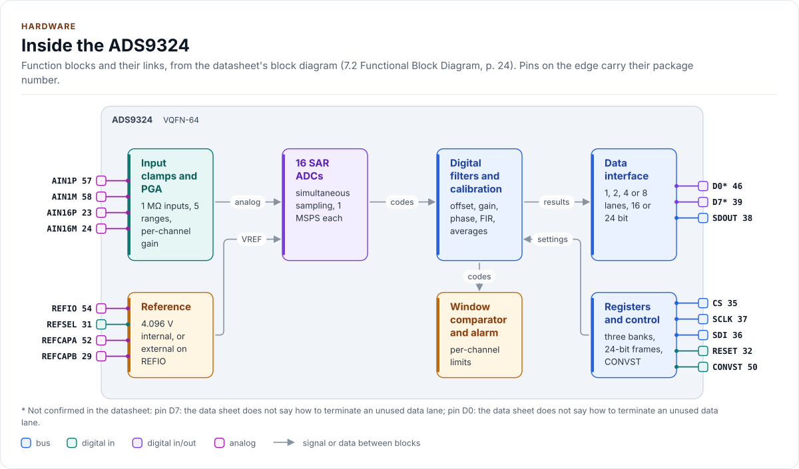
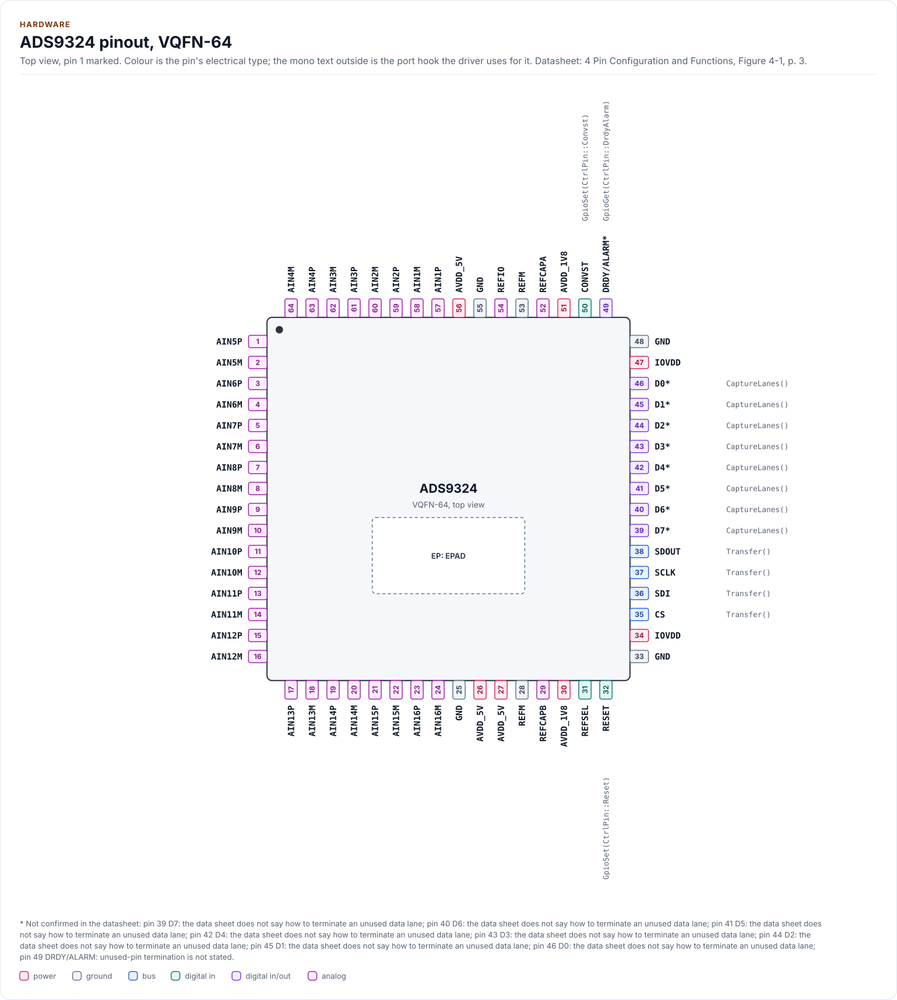
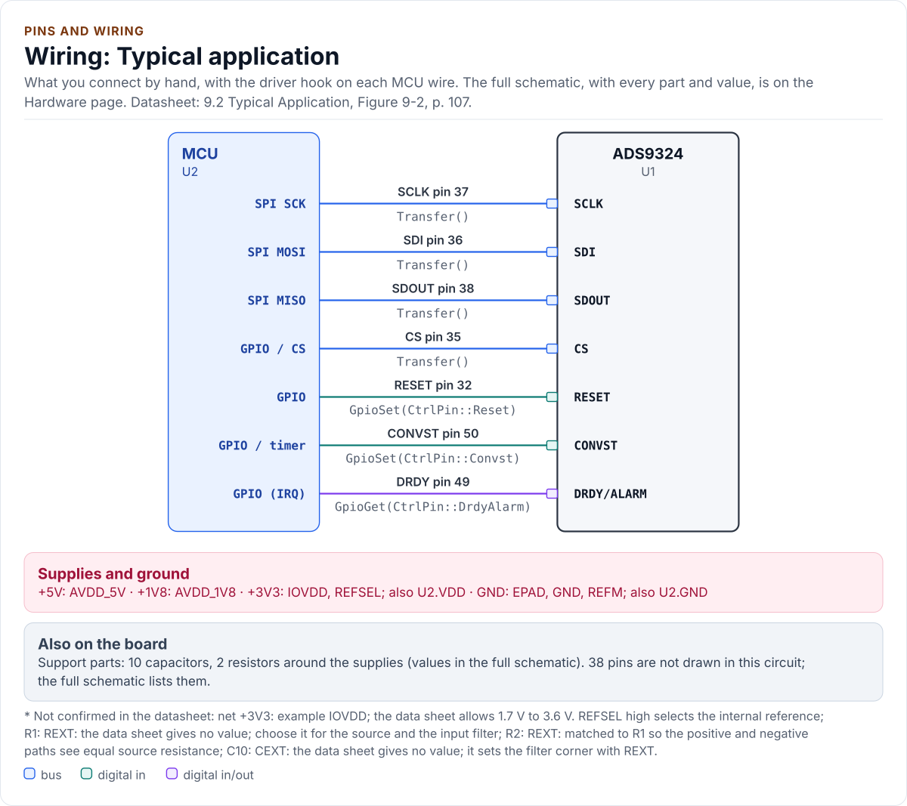
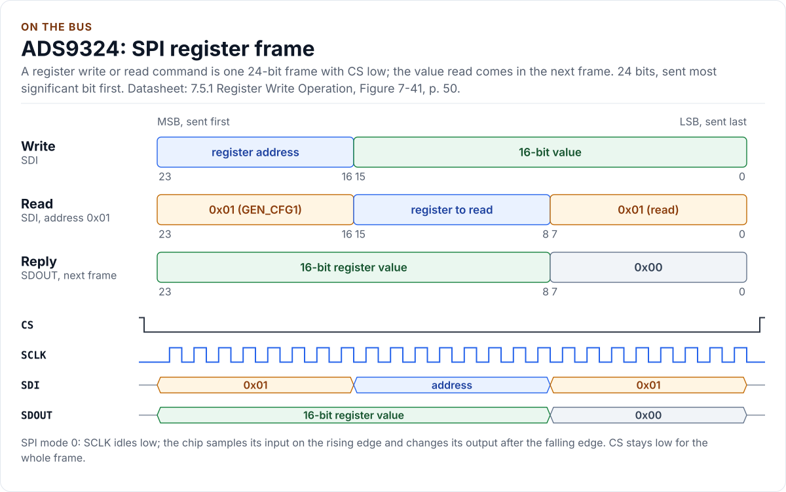

---
hide:
  - navigation
  - toc
---

<div class="kb-hero" markdown>
<span class="kb-kicker">Driver</span>

# ADS9324 Driver

<p>A C++20 driver for the TI ADS9324, a 16-channel, 16-bit, 1 MSPS simultaneous-sampling SAR ADC with an
integrated programmable-gain front end and an SPI interface. It starts the chip safely, programs every channel,
reads and decodes a whole frame of 16 samples, and runs the window comparator and the calibration, on any MCU.</p>

[Quickstart](quickstart.md){ .md-button .md-button--primary }
[API guide](api-guide.md){ .md-button }
[Source on GitHub](https://github.com/kokeb-labs-drivers/driver-ads9324){ .md-button }
</div>

<!-- generated: chip-summary -->
The **ADS9324** is a 16-channel, 16-bit SAR ADC that samples all of its inputs at the same instant at up to 1 MSPS, each
through its own programmable-gain front end with 1 MΩ input impedance, so sensors and transformers connect without
drivers (1 Features, [p. 1](https://www.ti.com/lit/ds/symlink/ads9324.pdf#page=1)).
<!-- /generated -->

<!-- figure: chip-hero -->
<picture>
  <source media="(prefers-color-scheme: dark)" srcset="diagrams/chip-hero.dark.svg">
  
</picture>
<!-- /figure -->

## What it does

<!-- figure: chip-capabilities -->
<picture>
  <source media="(prefers-color-scheme: dark)" srcset="diagrams/chip-capabilities.dark.svg">
  
</picture>
<!-- /figure -->

## Where it is used

<!-- generated: chip-uses -->
- Substation automation (2, [p. 1](https://www.ti.com/lit/ds/symlink/ads9324.pdf#page=1))
- Motor protection relays and contactors (2, [p. 1](https://www.ti.com/lit/ds/symlink/ads9324.pdf#page=1))
- Motor control current sensing (2, [p. 1](https://www.ti.com/lit/ds/symlink/ads9324.pdf#page=1))
- Industrial automation (2, [p. 1](https://www.ti.com/lit/ds/symlink/ads9324.pdf#page=1))
- Test and measurement (2, [p. 1](https://www.ti.com/lit/ds/symlink/ads9324.pdf#page=1))

Uses named by the datasheet (1 Features, [p. 1](https://www.ti.com/lit/ds/symlink/ads9324.pdf#page=1)).
<!-- /generated -->

## Inside the chip

<!-- figure: chip-blocks -->
<picture>
  <source media="(prefers-color-scheme: dark)" srcset="diagrams/chip-blocks.dark.svg">
  
</picture>
<!-- /figure -->

## Pins and wiring

<!-- figure: chip-pinout -->
<picture>
  <source media="(prefers-color-scheme: dark)" srcset="diagrams/chip-pinout.dark.svg">
  
</picture>
<!-- /figure -->

<!-- figure: chip-wiring-typical -->
<picture>
  <source media="(prefers-color-scheme: dark)" srcset="diagrams/chip-wiring-typical.dark.svg">
  
</picture>
<!-- /figure -->

<!-- figure: chip-frame-spi -->
<picture>
  <source media="(prefers-color-scheme: dark)" srcset="diagrams/chip-frame-spi.dark.svg">
  
</picture>
<!-- /figure -->

<div class="kb-chip" markdown>
<div class="kb-chip__head">
<span class="kb-chip__kicker">16-channel simultaneous-sampling ADC</span>
<span class="kb-chip__name">ADS9324</span>
<span class="kb-chip__vendor">Texas Instruments</span>
</div>

Function
:   16 channels sampled together, 16 bits each, up to 1 MSPS per channel; differential or single-ended inputs

Inputs
:   1 MΩ input impedance; ±2.5 V, ±5 V, ±6.25 V, ±10 V and ±12.5 V ranges per channel; 25 kHz or 325 kHz bandwidth

Interface
:   SPI for the registers (24-bit frames, up to 60 MHz); data on 1, 2, 4 or 8 lanes, 16 or 24 bits per channel

Digital
:   Block, moving-average and FIR filters; offset, gain and phase calibration; window comparator; alarm pin

Reference
:   Internal 4.096 V or external on REFIO

Supply
:   5 V analog, 1.8 V analog, 1.7 V to 3.6 V I/O
</div>

Every pin, the reference circuits, the bus settings, the timing and the power: [Hardware](hardware.md).

## Quick start

Wire the chip as above, write the port for your MCU ([Porting](porting.md)), then:

<!-- generated: quickstart-code -->
```cpp
#include "ads9324.hpp"

// This minimal port has no CONVST pin hook, so the example drives CONVST itself
// (see "Drive CONVST yourself" on the API guide); ReadFrame() reads the latest
// conversion.
int read_ain1_microvolts(MyPort& port, int32_t& microvolts) {
  ads9324::ADS9324<MyPort> adc(port); // no I/O yet

  if (auto r = adc.EnsureInitialized(); !r) { // 1. bus up, reset, DEVICE_ID, Config{}
    return static_cast<int>(r.error);         //    Bus, Timeout or DeviceIdMismatch: check wiring
  }
  // ... pulse CONVST here, wait 1.25 us ...
  const auto frame = adc.ReadFrame(); // 2. one frame: all 16 channels, 16 bits each
  if (!frame) {
    return static_cast<int>(frame.error); //    DataMismatch: SDOUT stuck low or high
  }
  microvolts = frame.value.microvolts[0]; // 3. AIN1, +-5 V range, in microvolts
  return 0;
}
```
<!-- /generated -->

Step by step, from a bare chip to the first result: [Quickstart](quickstart.md).

## Driver coverage

<!-- generated: chip-coverage -->
| Capability | What the chip does | Driver API | Registers | Status | Datasheet |
| --- | --- | --- | --- | --- | --- |
| [Simultaneous sampling](api-guide.md) | Samples all 16 inputs at one instant on CONVST and reads the whole frame of results | `Convert`, `WaitDataReady`, `ReadFrame`, `MeasureOnce`, `SetChannels` | `ANA_CFG2` | Supported | 7.1, [p. 24](https://www.ti.com/lit/ds/symlink/ads9324.pdf#page=24) |
| [Programmable gain front end](configuration.md) | Per channel: ±2.5 V to ±12.5 V, differential, single-ended or open-wire safe, 25 or 325 kHz bandwidth | `SetInput`, `Input` | `PGA_CONFIG`, `PGA_BW_SEL` | Supported | 7.3.4, [p. 26](https://www.ti.com/lit/ds/symlink/ads9324.pdf#page=26) |
| [Reference](configuration.md) | The internal 4.096 V reference and buffer, or an external reference | `SetReference`, `ReferenceSource` | `ANA_CFG1` | Supported | 7.3.6, [p. 28](https://www.ti.com/lit/ds/symlink/ads9324.pdf#page=28) |
| [Calibration](api-guide.md) | System offset, gain and phase per channel, and the chip's own ADC gain and offset calibration | `SetInput`, `RunAdcCalibration`, `IsCalibrationBusy` | `OFS`, `GAN`, `PHASE_DELAY`, `ADC_CAL` | Supported | 7.3.8, [p. 31](https://www.ti.com/lit/ds/symlink/ads9324.pdf#page=31) |
| [Digital filters](configuration.md) | Block average, moving average or low-pass FIR filtering of the oversampled results | `SetFilter`, `Filter` | `DIG_FILTER`, `GEN_CFG5` | Supported | 7.3.11, [p. 34](https://www.ti.com/lit/ds/symlink/ads9324.pdf#page=34) |
| [Window comparator](api-guide.md) | Flags a channel that leaves a high and low threshold with hysteresis, on the ALARM pin | `SetAlarm`, `ReadWindowFlags`, `ClearWindowFlags`, `ReadAlarmPin` | `DWC_CFG`, `DWC_TH`, `DWC_HYS`, `DWC_FLAG`, `DRDY_ALARM_SEL` | Supported | 7.3.12, [p. 39](https://www.ti.com/lit/ds/symlink/ads9324.pdf#page=39) |
| [Data interface](limitations.md) | 1, 2, 4 or 8 data lanes, 16- or 24-bit words, the output randomizer and test patterns (the daisy chain is not supported) | `SetInterface`, `CaptureLanes`, `SetTestPattern`, `RunDataPathSelfTest` | `GEN_CFG3`, `XOR_BITS_CTL`, `TP_CFG`, `GEN_CFG4` | Partial | 7.3.14, [p. 42](https://www.ti.com/lit/ds/symlink/ads9324.pdf#page=42) |
| [Standby](api-guide.md) | Powers down the analog front end and the reference, then wakes with the registers checked | `PowerDown`, `Wake`, `IsPoweredDown` | `PDN_CTL` | Supported | 7.4, [p. 49](https://www.ti.com/lit/ds/symlink/ads9324.pdf#page=49) |
| [Reset and identity](contract.md) | Hardware or software reset, the device ID check and the reset-detect flag | `Reset`, `Identify`, `EnsureInitialized` | `GEN_CFG1`, `DEVICE_ID`, `DIAG_CTRL` | Supported | 7.4, [p. 49](https://www.ti.com/lit/ds/symlink/ads9324.pdf#page=49) |

**Supported**: the driver covers it and a host test checks it; **Partial**: covered in part; the coverage map says which
part.

From [`docs/hardware.yml`](hardware.yml); `kokeb-docs hardware --check` confirms that every API name is in
`inc/ads9324.hpp`, `inc/ads9324_types.hpp` and every register in `inc/ads9324_registers.hpp`.
<!-- /generated -->

The driver has no platform code. You give it a small class that moves SPI frames and waits; it does the rest: the
reset sequence, the identity check, the three register banks (the AIN9 to AIN16 bank is laid out in reverse order,
and the driver knows), the data frame in every lane and word format, unit conversion and bounded waits.

### What you get

- **One object per chip.** `ADS9324<YourPort>` takes a reference to your port and does no I/O until
  `EnsureInitialized()`. See [API guide](api-guide.md).
- **Errors you can act on.** Every call returns `Result<T>` with an `Error` such as `Bus`, `Timeout`,
  `DeviceIdMismatch` or `UnexpectedReset`. See [API guide](api-guide.md#handle-errors).
- **A configuration that is checked.** `Config{}` is the datasheet's initialisation example; `Validate()` rejects
  an impossible combination before any bus traffic, and `CheckedConfig` rejects it at compile time. See
  [Configuration](configuration.md).
- **Per-channel settings that land on the right channel.** The AIN9 to AIN16 registers are in reverse order; the
  driver maps every channel and the host tests prove it for all 16. See [Architecture](architecture.md).
- **Every data format.** 1, 2, 4 or 8 lanes, 16- or 24-bit words, the diagnostic byte and the randomizer,
  all 15 channel modes. See [Configuration](configuration.md#data-interface).
- **Zero-overhead portability.** The port is a CRTP class checked by a concept: the bus hooks and a delay, plus
  optional CONVST, RESET, DRDY and lane-capture hooks found at compile time. See [Porting](porting.md).
- **No heap, no exceptions, no RTTI, no floating point.** See [Contract](contract.md).
- **Tested without hardware.** Host tests run the driver against an independent model of the chip. See
  [Testing and CI](testing.md).

## Datasheet

<!-- generated: datasheet-card -->
| Document | Revision | Get it |
| --- | --- | --- |
| Datasheet: ADS9324 16-Channel, 16-Bit, 1MSPS, Simultaneous-Sampling SAR ADC With Integrated Analog Front-End (Texas Instruments SBASB22) | -, 2025-12 | [PDF](https://www.ti.com/lit/ds/symlink/ads9324.pdf) · [vendor page](https://www.ti.com/product/ADS9324) |

Written against these revisions; the SHA-256 of each file is in [`docs/datasheets.yml`](datasheets.yml). Where each part
of the driver is in the datasheet: [Datasheet map](datasheet.md).
<!-- /generated -->

## Where to go next

<div class="grid cards" markdown>

-   :material-rocket-launch-outline: **[Quickstart](quickstart.md)**

    ---

    Wire the chip, write the port, read the 16 channels.

-   :material-chip: **[Hardware](hardware.md)**

    ---

    Pins, supplies, reference, bus settings and timing.

-   :material-file-document-check-outline: **[Contract](contract.md)**

    ---

    What the driver promises, what it needs, threading and errors.

-   :material-code-braces: **[API guide](api-guide.md)**

    ---

    Initialise, configure, measure, set windows and calibrate, task by task.

-   :material-swap-horizontal: **[Porting](porting.md)**

    ---

    Implement the port for your MCU.

-   :material-alert-circle-outline: **[Limitations](limitations.md)**

    ---

    What is not supported, and what is not verified on hardware.

</div>
